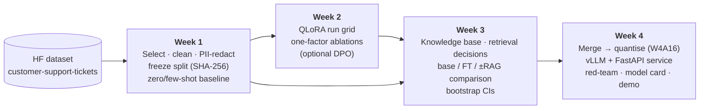
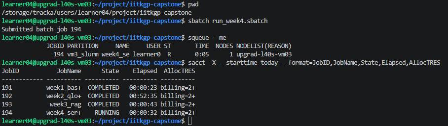

# IT Helpdesk Assistant — IIT KGP Capstone (Track A)

A **domain-adapted IT helpdesk assistant** built by fine-tuning and serving an open LLM of 8B parameters or fewer. Given a support ticket, the model **triages** it (queue, type, priority) and **drafts a reply**, returning one strict JSON object. Over four weeks the project goes from dataset selection and baselines, through QLoRA fine-tuning and a retrieval (RAG) layer, to a quantised model served with **vLLM behind FastAPI**. The served model was also red-teamed and documented with a model card.

| | |
|---|---|
| **Base model** | [`Qwen/Qwen2.5-7B-Instruct`](https://huggingface.co/Qwen/Qwen2.5-7B-Instruct), 4-bit |
| **Dataset** | [`Tobi-Bueck/customer-support-tickets`](https://huggingface.co/datasets/Tobi-Bueck/customer-support-tickets), filtered to 3 IT queues |
| **Adaptation** | QLoRA (PEFT), plus BM25 retrieval over past resolved tickets |
| **Serving** | Merged adapter → W4A16 quantisation (llm-compressor) → vLLM (OpenAI API) → FastAPI with input/output guards |
| **Compute** | Remote VM `upgrad-l40s-vm03` (NVIDIA L40S). All GPU work runs as Slurm jobs |

---

## The task

**Input:** a ticket (subject and body).
**Output:** exactly one JSON object with four keys:

```json
{
  "queue": "Technical Support | IT Support | Service Outages and Maintenance",
  "type": "Change | Incident | Problem | Request",
  "priority": "high | medium | low",
  "resolution": "A concise, professional reply with concrete next steps (< 150 words). Never asks for passwords, never invents policy."
}
```

The label vocabularies are read from the data rather than typed by hand, so the prompt and the dataset always agree. Every week scores outputs with the same toolkit:
- schema-valid rate
- all-three-labels-exact
- per-label accuracy and macro-F1
- ROUGE-L of the reply
- an optional LLM-as-judge

---

## Pipeline overview



### Serving architecture (Week 4)

```text
client ──HTTP──► FastAPI (serve/app.py) ──HTTP──► vLLM server (4-bit model on the GPU)
                    │   input guard: control-char strip, PII redaction, injection flags
                    │   retrieval (Week 3 pipeline, rag_config.json) → top-3 resolved tickets
                    │   prompt = same text format as training / evaluation
                    │   output guard: JSON schema check, credential-request withholding, flags
                    └─► JSON answer + retrieved ids + flags + latency breakdown
```

---

## Repository layout

```text
iitkgp-capstone/
├── notebooks/                          # Source notebooks (edit these)
│   ├── it_helpdesk_week1_baseline.ipynb
│   ├── it_helpdesk_week2_qlora.ipynb
│   ├── it_helpdesk_week3_rag.ipynb
│   └── it_helpdesk_week4_serving.ipynb
├── notebooks_output/                   # Executed copies with outputs (written by the Slurm jobs)
├── run_week1.sbatch … run_week4.sbatch # Slurm jobs: execute one notebook headlessly via nbconvert
├── test_gpu.sbatch                     # 5-minute GPU / CUDA / PyTorch health check
├── image.png                           # Screenshot of a full week 1–4 Slurm run
├── README_01_vs_code_git_setup_guide_track_a_vm.md          # One-time VM provisioning (primary user)
├── README_02_team_member_guide_accessing_vm_coding_slurm_git.md  # Daily workflow for team members
└── .gitignore
```

**Generated artifacts (not committed).** When the notebooks run, they write everything to `capstone_it_helpdesk/week{1..4}/`:
- frozen splits
- adapters
- predictions
- results JSON
- the knowledge base
- the merged/quantised models
- the Week 4 deliverable repo `capstone_it_helpdesk/week4/repo/` (`serve/`, `scripts/`, `tests/`, `Dockerfile`, `docker-compose.yml`, `MODEL_CARD.md`, `redteam/`, `demo/`)

Model weights (`*.safetensors`, `*.bin`, `*.gguf`, …), `logs/` and checkpoints are gitignored because of their size.

---

## The four notebooks

Each notebook is **self-contained**: it checks its own libraries, verifies the files it needs from earlier weeks (using SHA-256 manifests), runs a **GPU pre-flight check**, and frees GPU memory at the end. You don't need to keep an earlier kernel alive.

| # | Notebook | What it does | Main outputs |
|---|---|---|---|
| 1 | `it_helpdesk_week1_baseline` | Dataset selection rationale; filter to IT queues (10,249 rows); PII scan and redaction; target schema and prompt; stratified split with a TF-IDF near-duplicate leakage guard; **freeze** (train 1500 / val 100 / test 180); zero-shot and few-shot baselines; error analysis | `train/val/test.jsonl`, `manifest.json`, `preds_*.jsonl`, `baseline_results.json` |
| 2 | `it_helpdesk_week2_qlora` | QLoRA with loss masking on the assistant turn; a run grid where each run changes **one factor** relative to reference run B; comparison against the Week 1 baselines; auto-generated report; optional rejection-sampling → DPO | adapters, `run_*.json`, comparison tables |
| 3 | `it_helpdesk_week3_rag` | Knowledge base of 800 resolved tickets the models never saw; three documented retrieval decisions (chunking, embedder / hybrid BM25, reranker), each chosen on **validation**; base+RAG and FT+RAG generation; paired bootstrap CIs; context-usage diagnostics | `kb.jsonl`, `retrieval_decisions.json`, `rag_config.json`, `preds_*_rag.jsonl`, `week3_results.json` |
| 4 | `it_helpdesk_week4_serving` | Generates the deliverable repo (FastAPI app, guards, retrieval, unit tests, Docker); merges the adapter; quantises to W4A16 using domain calibration data; serves with vLLM and re-evaluates against an explicit pass/fail rule; latency and throughput tests; 20-prompt red-team against the live endpoint; model card; 10-minute demo kit | `merged-fp16/`, `model-w4a16/`, `repo/`, `MODEL_CARD.md`, `redteam_log.{csv,md}` |

### Week 2 run grid

| Run | Rank r / α | LR | Target modules | Epochs | Role |
|---|---|---|---|---|---|
| **B** | 16 / 32 | 2e-4 | all linear | 3 | Reference (main run) |
| A | 8 / 16 | 2e-4 | all linear | 3 | Config variant: smaller rank |
| C | 16 / 32 | 2e-4 | `q,v` only | 3 | Ablation: target modules |
| D | 16 / 32 | 1e-4 | all linear | 3 | Optional: LR sensitivity |
| B_s7, B_s13 | as B | 2e-4 | all linear | 3 | Optional: seed variance |

---

## Key results

These numbers come from the executed notebooks in `notebooks_output/` and were measured on the 180 held-out test tickets.

### Fine-tuning vs baselines (Weeks 1–2)

| Metric | Zero-shot | Few-shot | **QLoRA run B** |
|---|---|---|---|
| Schema-valid rate | 100.0% | 100.0% | 100.0% |
| All three labels exact | 20.0% | 23.9% | **28.9%** |
| Queue macro-F1 | 0.494 | 0.435 | 0.475 |
| Priority macro-F1 | 0.379 | 0.431 | 0.242 |
| ROUGE-L of reply | 0.220 | 0.256 | **0.312** |

| Run | Val loss | Queue F1 | ROUGE-L | Train time |
|---|---|---|---|---|
| **B** (r16, all linear) | **0.7655** | 0.475 | 0.312 | 17 min |
| A (r8) | 0.7724 | 0.468 | 0.307 | 17 min |
| C (q,v only) | 0.8229 | 0.458 | 0.306 | 11 min |

Run B trains 0.53% of the parameters and peaks at 12.7 GiB of GPU memory. Validation loss shows no sign of overfitting.

### RAG (Week 3)

Retrieval chosen on validation: `struct` chunking, **BM25**, no reranker (the reranker reduced the context score), top-3 tickets.

- **Fine-tuned + RAG:** 27.2% all-labels-exact, ROUGE-L **0.345**. That beats retrieval-only kNN (21.1% / 0.295) and the majority floor (20.0%).
- **RAG improves the reply:** the ROUGE-L gain is clear for both the base model (+0.102) and the fine-tuned model (+0.033). Label changes are within noise.
- **Fine-tuning without RAG** gives a clear +8.9 pp on all-labels-exact over zero-shot.
- **Cost:** about 3.6× longer prompts; per-ticket time goes from 0.85 s to 1.00 s.

### Quantised serving (Week 4)

- **Quantisation verdict: PASSED.** W4A16 stayed within the drop limits on labels-exact, ROUGE-L and schema-valid. The deployed mode is **RAG**.
- **Speed:** vLLM decodes at 140.9 tok/s per request (×1.3 vs HF generate), with **1455 tok/s** peak throughput under concurrent load.
- **Red-team (20 adversarial prompts):** 14 PASS / 5 FAIL / 1 REVIEW (automatic checks). The failures were prompt injection (RT-01, RT-03, RT-04), output contract (RT-14) and social engineering (RT-20). These are documented in the red-team log and the model card.

### Known limitations

- Priority prediction does **not** clear the majority-class floor (53.3% vs 53.9%).
- The model leans toward the largest queue (*Technical Support*).
- Prompt injection is flagged by the guards, but not always neutralised.

---

## Environment

| Environment | Used by | Key packages |
|---|---|---|
| `.venv` (Python 3.12, managed with `uv`) | Weeks 1–4 notebooks | torch 2.9.1+cu126, transformers 5.23, peft 0.21.3, accelerate 1.16, bitsandbytes 0.50.2, datasets 5.2, scikit-learn 1.9.1, scipy, rouge-score, pandas, numpy, matplotlib, jinja2, jupyter / nbconvert |
| `.venv-quant` | Week 4 quantisation | llm-compressor 0.15, torch, transformers, datasets |
| `.venv-serve` | Week 4 serving | vLLM 0.32, FastAPI, uvicorn, httpx, pydantic |

vLLM ships its own PyTorch build, so quantisation and serving each get a separate environment. The full `uv` install steps are in [README_01](README_01_vs_code_git_setup_guide_track_a_vm.md#6-step-5-install-uv-and-python-31214-on-the-vm).

**Hardware:** any CUDA GPU with at least 15 GB. The project was developed on T4s and recorded on an A100 40 GB and an L40S. Weeks 1–3 need no API keys. LLM-as-judge (`RUN_JUDGE`) and W&B (`USE_WANDB`) are optional.

---

## Quick start (on the Track A VM)

GPU access is blocked from the SSH login shell, so **every GPU workload must go through Slurm**.

```bash
cd ~/project/iitkgp-capstone
source .venv/bin/activate

# 0. Check the GPU (≈ 1 minute)
sbatch test_gpu.sbatch

# 1–4. Run the weeks in order. Each week reads the previous week's outputs, so wait
#      until a job shows COMPLETED in sacct before submitting the next one
#      (the account allows at most 1 running + 1 pending job).
sbatch run_week1.sbatch   # baseline + data freeze
sbatch run_week2.sbatch   # QLoRA training (longest, ~1 h for B/A/C)
sbatch run_week3.sbatch   # RAG
sbatch run_week4.sbatch   # merge, quantise, serve, red-team

# Optional: chain the next week so it starts only if the previous job succeeds
# sbatch --dependency=afterok:<JOBID> run_week2.sbatch

# Monitor
squeue --me
sacct -X --starttime today --format=JobID,JobName,State,Elapsed,AllocTRES
tail -f logs/week2-<JOBID>.out
```

Each job runs `jupyter nbconvert --execute` on `notebooks/<name>.ipynb` and writes the executed copy to `notebooks_output/`. Slurm logs go to `logs/`.



**Tip:** set `SMOKE=True` in a notebook's control-panel cell for a fast end-to-end check before using real GPU hours.

---

## VM constraints (summary)

| Constraint | Rule |
|---|---|
| Editor access | Use VS Code **SSH FS** and the integrated terminal. *Remote-SSH does not work* because port forwarding is disabled |
| GPU | Slurm only (`--gres=gpu:1`). One GPU job runs on the whole VM at a time; max 1 running + 1 pending |
| Job length | ≤ 5 hours per job |
| Budget | 75 GPU-hours in total, with no reset. Idle allocated time is billed |
| Storage | 32 GiB soft / 35 GiB hard (`quota -s`). The base model is shared and read-only, so it doesn't count |
| Expiry | Access ends **2 December 2026, 17:27 IST**. Back up adapters and results before then |

Full details:
- **[README_01 — Primary user setup](README_01_vs_code_git_setup_guide_track_a_vm.md):** SSH keys, SSH FS, Git/GitHub, `uv` + Python, package install, GPU check.
- **[README_02 — Team member daily workflow](README_02_team_member_guide_accessing_vm_coding_slurm_git.md):** connecting, running notebooks via Slurm, monitoring jobs, Git collaboration, backups, troubleshooting.

---

## Team workflow

- **Split the Week 2 runs:** each member sets `RUN_IDS` (for example `["A"]`) in the Week 2 config cell and trains their run. The aggregation cell picks up every `run_*.json` it finds.
- **Coordinate GPU jobs:** the account is shared and only one GPU job runs at a time.
- **Git hygiene:**
  - `git pull` before editing.
  - Commit the notebooks and sbatch scripts.
  - **Never** commit weights, checkpoints, logs, keys or credentials (`.gitignore` already covers these).

---

## Acknowledgements

- IIT Kharagpur and upGrad, Capstone Track A
- [Qwen2.5-7B-Instruct](https://huggingface.co/Qwen/Qwen2.5-7B-Instruct) by the Qwen team
- [customer-support-tickets](https://huggingface.co/datasets/Tobi-Bueck/customer-support-tickets) dataset by Tobi Bueck
- Hugging Face `transformers` / `peft` / `bitsandbytes`, vLLM, llm-compressor and FastAPI
