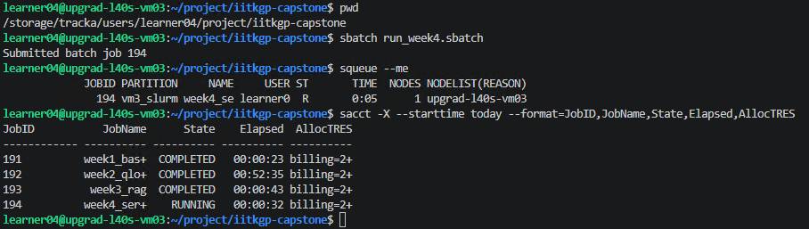

# Track A Remote VM: Team Member Daily Workflow Guide

Welcome to the IIT KGP Capstone environment on `upgrad-l40s-vm03`. The primary user has already provisioned the Git repository, `uv`, Python **3.12.14**, `jupyter`/`nbconvert`, and the `.venv` virtual environment containing all **19 pinned ML/Python packages**.

This guide explains how **subsequent users / team members** connect to the VM via VS Code, edit `.ipynb` and `.py` files, test the GPU, execute notebooks and training jobs through **Slurm (`sbatch`)**, and collaborate cleanly using **Git & GitHub**.



---

## 1. Shared Account Ground Rules & Limits

All team members share the `learner04` account on `upgrad-l40s-vm03`. Coordinate before running heavy jobs or changing shared files:

| Resource / Policy | Limit / Rule |
| :--- | :--- |
| **GPU Allowance** | **75 GPU-hours total** for the account (no automatic reset). Idle allocated GPU time is billed; queue wait time is not. |
| **Job Concurrency** | Only **1 GPU job runs across the entire VM** at a time. Max **1 running + 1 pending** job for `learner04`. |
| **Max Job Duration** | **5 hours** maximum per job, always requesting `--gres=gpu:1`. |
| **Direct GPU Access** | **Blocked** in the SSH login shell. All GPU tests, notebook executions, training, and inference **must** run via Slurm (`sbatch`). |
| **Private Storage Quota** | **32 GiB soft / 35 GiB hard** limit. Check frequently with `quota -s`. |
| **Notebook Folders** | Input `.ipynb` files live in `notebooks/`; executed `.ipynb` outputs go to `notebooks_output/`. |
| **Access Expiration** | **`2 December 2026 at 17:27:52 IST`** — all jobs cancel and SSH expires at this time. Back up work beforehand. |

> **Important:** Do **not** install Microsoft's **Remote - SSH** extension for this VM. SSH port forwarding is disabled on `upgrad-l40s-vm03`, so Remote-SSH will hang indefinitely. Always use **SSH FS** + **VS Code's Integrated Terminal**.

---

## 2. One-Time Local Workstation Setup

Get the `id_ed25519` private key file and passphrase from your primary user/coordinator and save the key locally (e.g., inside `Downloads\TrackA_VM03_Group04\`).

### Step 1: Protect the Private Key File
* **Windows (PowerShell):** Replace `<YourUsername>` and the path if you saved the key elsewhere:
  ```powershell
  $key = "C:\Users\<YourUsername>\Downloads\TrackA_VM03_Group04\id_ed25519"
  icacls $key /reset
  icacls $key /inheritance:r
  icacls $key /grant:r "${env:USERNAME}:(R)"
  ```
* **macOS / Linux (Terminal):**
  ```bash
  chmod 600 "$HOME/Downloads/TrackA_VM03_Group04/id_ed25519"
  ```

### Step 2: Add the SSH Alias (`~/.ssh/config`)
Open `C:\Users\<YourUsername>\.ssh\config` (Windows) or `~/.ssh/config` (macOS/Linux) and add:

```text
Host upgrad-l40s-vm03
    HostName 103.42.50.41
    Port 1026
    User learner04
    IdentityFile "C:\Users\<YourUsername>\Downloads\TrackA_VM03_Group04\id_ed25519"
    IdentitiesOnly yes
```
*(On macOS/Linux, use the Unix path such as `/Users/<YourUsername>/Downloads/TrackA_VM03_Group04/id_ed25519`.)*

Test in a terminal with `ssh upgrad-l40s-vm03`. On first connection, verify the server fingerprint matches:
`SHA256:5Ij30L5ol/uHzx7D7a6zdTQNGKIl6WSlRgHHAMRI2tY`
Type `yes` and enter the key passphrase.

### Step 3: Set Up VS Code with SSH FS (Copy-Paste `settings.json` or UI Form)
First, open **VS Code**, press `Ctrl + Shift + X`, search for **SSH FS** (by **Kelvin Schoofs**), and click **Install**.

#### Option A: Fast Copy-Paste into `settings.json` (Recommended)
1. Press `Ctrl + Shift + P` → type **Preferences: Open User Settings (JSON)** → press `Enter`.
2. Paste the block below inside the outer `{ ... }` JSON object, replacing `<YourUsername>` with your actual username:
   ```json
   "sshfs.configs": [
     {
       "name": "upgrad-l40s-vm03",
       "label": "upgrad-l40s-vm03 (Track A)",
       "host": "103.42.50.41",
       "port": 1026,
       "username": "learner04",
       "root": "/storage/tracka/users/learner04/project",
       "privateKeyPath": "C:\\Users\\<YourUsername>\\Downloads\\TrackA_VM03_Group04\\id_ed25519",
       "passphrase": true
     }
   ],
   "terminal.integrated.cwd": "C:\\Users\\<YourUsername>"
   ```
   *(On **macOS / Linux**, use forward slashes instead, e.g., `"/Users/<YourUsername>/Downloads/TrackA_VM03_Group04/id_ed25519"` and `"/Users/<YourUsername>"`.)*
3. Save `settings.json` (`Ctrl + S`).

#### Option B: Configure via the SSH FS UI Form
1. Click the **SSH FS** icon in the left Activity Bar → click **+** next to **Configurations** → name it `upgrad-l40s-vm03` → click **Configure**.
2. Enter:
   * **Root:** `/storage/tracka/users/learner04/project`
   * **Host:** `103.42.50.41`
   * **Port:** `1026`
   * **Username:** `learner04`
   * **Private Key Path:** Your local path to `id_ed25519`
   * **Passphrase:** Select **Prompt**
3. Click **Save**, and set `terminal.integrated.cwd` in VS Code Settings (`Ctrl + ,`) to your local home directory to prevent local terminal launch errors.

#### Mount the Remote Folder
Hover over `upgrad-l40s-vm03` in the **SSH FS** sidebar and click **Add as Workspace folder** (folder with `+`). Enter your passphrase in the top bar when prompted. Press `Ctrl + Shift + E` (**Explorer**) to see and edit all VM files directly.

---

## 3. Opening a Remote Terminal & Activating the Environment

You have two ways to open a terminal on the VM inside VS Code:
* **Method A (Fastest):** Click the **SSH FS** icon → hover over `upgrad-l40s-vm03` → click the **Open terminal** (`>_`) icon.
* **Method B (Standard Terminal):** Press `` Ctrl + ` `` to open a local terminal and run `ssh upgrad-l40s-vm03`.

Once logged into the VM, navigate to the repo and activate the shared **`uv`** virtual environment:

```bash
cd ~/project/iitkgp-capstone
source .venv/bin/activate
```

**Verify the environment is active:**
```bash
which python          # Should point to .../iitkgp-capstone/.venv/bin/python
python --version      # Should print Python 3.12.14
jupyter --version     # Confirms jupyter & nbconvert are available
```

> **Note on Installing New Packages:** Do **not** blindly upgrade `torch`, `transformers`, `peft`, or `bitsandbytes` (they are pinned to match the 4 capstone notebooks). If you must add a lightweight utility package, coordinate with the team and install it with `uv`:
> ```bash
> source "$HOME/.local/bin/env"
> uv pip install --python .venv/bin/python <package-name>
> ```

---

## 4. How to Test the GPU (Quick `sbatch` Health Check)

Direct GPU usage is blocked on the SSH login node (running `torch.cuda.is_available()` in the login shell will always return `False`). To verify that the GPU, NVIDIA driver, and PyTorch CUDA build are working properly, submit a quick 5-second Slurm job.

1. **Create `test_gpu.sbatch`** inside `~/project/iitkgp-capstone` (if not already present):
   ```bash
   cd ~/project/iitkgp-capstone
   mkdir -p logs

   cat << 'EOF' > test_gpu.sbatch
   #!/bin/bash
   #SBATCH --job-name=test_gpu
   #SBATCH --gres=gpu:1
   #SBATCH --time=00:05:00
   #SBATCH --output=logs/test_gpu-%j.out
   #SBATCH --error=logs/test_gpu-%j.err

   source /storage/tracka/users/learner04/project/iitkgp-capstone/.venv/bin/activate

   echo "=== nvidia-smi ==="
   nvidia-smi

   echo "=== PyTorch CUDA Check ==="
   python -c "
   import torch
   print('PyTorch:', torch.__version__)
   print('CUDA available:', torch.cuda.is_available())
   assert torch.cuda.is_available(), 'CUDA is not available!'
   print('Device count:', torch.cuda.device_count())
   print('Device name:', torch.cuda.get_device_name(0))
   free, total = torch.cuda.mem_get_info(0)
   print(f'VRAM: {free/2**30:.1f} GiB free / {total/2**30:.1f} GiB total')
   x = torch.randn((1024, 1024), device='cuda')
   print('Matrix multiply test OK:', (x @ x).mean().item())
   "
   EOF
   ```
2. **Submit and monitor:**
   ```bash
   sbatch test_gpu.sbatch
   squeue --me
   ```
3. **Check the output** (replace `<JOB_ID>` with your job number):
   ```bash
   cat logs/test_gpu-<JOB_ID>.out
   cat logs/test_gpu-<JOB_ID>.err
   ```
   A healthy GPU node prints `CUDA available: True`, the GPU model and free VRAM, and `Matrix multiply test OK`.

---

## 5. Coding & Executing `.ipynb` Notebooks and `.py` Scripts

### Folder Convention
* **Input notebooks:** `~/project/iitkgp-capstone/notebooks/` (e.g., `notebooks/it_helpdesk_week1_baseline.ipynb`)
* **Executed output notebooks:** `~/project/iitkgp-capstone/notebooks_output/` (e.g., `notebooks_output/it_helpdesk_week1_baseline.ipynb`)
* **Slurm logs:** `~/project/iitkgp-capstone/logs/`

### Editing Files Directly on the VM
* Open any `.ipynb`, `.py`, `.sbatch`, or `.jsonl` file from the VS Code **Explorer** sidebar (`upgrad-l40s-vm03`).
* Pressing `Ctrl + S` saves your edits immediately to `/storage/tracka/users/learner04/project/...` on the VM via **SSH FS**.

### Running `.ipynb` Notebooks on the GPU via Slurm (`sbatch`)
Because `upgrad-l40s-vm03` has **no hosted Jupyter server**, **no SSH port forwarding**, and **blocks direct GPU usage in the login shell**, always execute GPU notebooks via `sbatch` using `jupyter nbconvert`.

1. **Create a Slurm script** (e.g., `run_week1.sbatch`) inside `~/project/iitkgp-capstone`:
   ```bash
   cat << 'EOF' > run_week1.sbatch
   #!/bin/bash
   #SBATCH --job-name=week1_baseline
   #SBATCH --gres=gpu:1
   #SBATCH --time=02:00:00
   #SBATCH --output=logs/week1-%j.out
   #SBATCH --error=logs/week1-%j.err

   mkdir -p logs notebooks_output
   source /storage/tracka/users/learner04/project/iitkgp-capstone/.venv/bin/activate

   jupyter nbconvert --to notebook --execute \
     --ExecutePreprocessor.timeout=-1 \
     notebooks/it_helpdesk_week1_baseline.ipynb \
     --output-dir notebooks_output \
     --output it_helpdesk_week1_baseline.ipynb
   EOF
   ```
   > **Key Flags Explained:**
   > * `--ExecutePreprocessor.timeout=-1` prevents `nbconvert` from aborting long-running training or inference cells.
   > * `--output-dir notebooks_output` and `--output <filename>.ipynb` write the executed notebook cleanly into `notebooks_output/` without overwriting your source file in `notebooks/`.

2. **Submit the job and watch the logs:**
   ```bash
   mkdir -p logs notebooks_output
   sbatch run_week1.sbatch
   squeue --me
   ```
   Once the job state changes from `PD` (pending) to `R` (running), follow the live logs (replace `<JOB_ID>` with the number returned by `sbatch`):
   ```bash
   tail -f logs/week1-<JOB_ID>.out logs/week1-<JOB_ID>.err
   ```

3. **View the Executed Notebook:**
   When the job finishes, open `notebooks_output/it_helpdesk_week1_baseline.ipynb` in VS Code via **SSH FS** to inspect all rendered tables, plots, and cell outputs.

### Running `.py` Scripts & CPU Checks
* **For GPU `.py` scripts (`train.py`, `infer.py`):** Run them inside an `.sbatch` script after activating `.venv`:
  ```bash
  source /storage/tracka/users/learner04/project/iitkgp-capstone/.venv/bin/activate
  python train.py
  ```
* **For lightweight CPU-only checks (no GPU):** You can run `pytest`, `python train.py --help`, or dataset validation directly in the SSH terminal after running `source .venv/bin/activate`.

---

## 6. Monitoring & Managing Slurm Jobs

### Common Slurm Commands
```bash
# Submit a batch job (note the returned JOB_ID)
sbatch run_week1.sbatch

# Check your queued/running jobs (PD = Pending, R = Running)
squeue --me

# View final status & elapsed time for today's completed jobs (replace 'today' with YYYY-MM-DD if older)
sacct -X --starttime today --format=JobID,JobName,State,Elapsed,AllocTRES

# Read logs or training summaries (replace 123 with your JOB_ID)
JOB_ID=123
tail -n 40 logs/week1-$JOB_ID.out
tail -n 40 logs/week1-$JOB_ID.err
cat "$HOME/checkpoints/job-$JOB_ID/training_summary.json"

# Cancel a stuck or unneeded job immediately to save GPU-hours
scancel "$JOB_ID"
```

* Do **not** resubmit a job just because its state is `PD` (only 1 GPU job runs at a time across all 5 learners).
* Submitted `sbatch` jobs continue running safely even after you close VS Code or disconnect SSH.
* Always keep `#SBATCH --gres=gpu:1`, request a realistic `#SBATCH --time` (max `05:00:00`), and write model checkpoints to a **new, job-specific output directory**.

---

## 7. Git & GitHub Collaboration Workflow

Because all team members share `~/project/iitkgp-capstone` on the VM, follow this disciplined workflow to avoid overwriting each other's work:

### Before Starting Work
```bash
cd ~/project/iitkgp-capstone
git status          # Check if a teammate left uncommitted edits
git pull            # Sync latest changes from GitHub
```

### After Editing Code or Notebooks
1. **Review what changed** (never commit large datasets, checkpoints, logs, or `.venv/`):
   ```bash
   git status
   git diff
   ```
2. **Stage, commit, and push:**
   ```bash
   git add <file1> <file2>
   git commit -m "Clear description of your change (e.g., Update week1 baseline notebook)"
   git push
   ```
3. **Working on a Feature Branch (Recommended for Parallel Edits):**
   ```bash
   git checkout -b feature/<your-name>-<task>
   # ... edit, commit ...
   git push -u origin feature/<your-name>-<task>
   ```
   Then open a Pull Request on GitHub (`https://github.com/soumen-chatterjee/iitkgp-capstone`) to merge cleanly into `main`.

> **Tip:** To attribute a commit to yourself on the shared `learner04` account without changing the global Git config, pass `--author`:
> ```bash
> git commit --author="Your Name <your-github-id+username@users.noreply.github.com>" -m "Your message"
> ```

---

## 8. Storage Cleanup & Backing Up Before Access Expires

### Check & Manage Disk Quota
```bash
quota -s
du -sh ~/project/* ~/checkpoints/* 2>/dev/null
```
Each training run keeps periodic checkpoints plus the final adapter under `~/checkpoints/job-<JOB_ID>`. Delete obsolete failed runs (`rm -rf ~/checkpoints/job-<OLD_ID>`) to stay comfortably below the **32 GiB soft limit**.

### Download Code & Trained Adapters to Your Local Computer
Run these commands in a **local terminal** (not inside the VM) regularly, and **definitely before `2 December 2026 at 17:27:52 IST`**:

* **Windows PowerShell:**
  ```powershell
  # Backup project code & notebooks_output
  scp -i "C:\Users\<YourUsername>\Downloads\TrackA_VM03_Group04\id_ed25519" `
    -P 1026 -r learner04@103.42.50.41:project `
    "$env:USERPROFILE\Downloads\TrackA_project_backup"

  # Backup saved LoRA adapters/checkpoints
  scp -i "C:\Users\<YourUsername>\Downloads\TrackA_VM03_Group04\id_ed25519" `
    -P 1026 -r learner04@103.42.50.41:checkpoints `
    "$env:USERPROFILE\Downloads\TrackA_checkpoints_backup"
  ```
* **macOS / Linux:**
  ```bash
  scp -i "$HOME/Downloads/TrackA_VM03_Group04/id_ed25519" \
    -P 1026 -r learner04@103.42.50.41:project \
    "$HOME/Downloads/TrackA_project_backup"
  ```
*(Note: `scp` uses uppercase `-P 1026` for the port, whereas `ssh` uses lowercase `-p 1026`.)*

---

## 9. Quick Troubleshooting Cheat Sheet

### A. VS Code SSH FS Troubleshooting

| SSH FS Symptom / Error | Cause & Fix |
| :--- | :--- |
| **`All configured authentication methods failed`** | Check that `privateKeyPath` points to `id_ed25519` (not `.pub`), uses double backslashes (`\\`) on Windows inside `settings.json`, and that you entered the passphrase in the top VS Code bar before it timed out. |
| **Remote files stop loading or saving after sleep / network switch** | The SFTP connection dropped. Click **Disconnect** next to `upgrad-l40s-vm03` in the **SSH FS** sidebar (or run `Ctrl + Shift + P` → **Developer: Reload Window**) and mount again. |
| **VS Code terminal fails: `Starting directory (cwd) "\storage\..." does not exist`** | VS Code tried to open local PowerShell in a remote Linux path. Use the **SSH FS** `>_` terminal icon, or set `"terminal.integrated.cwd"` to your local home folder in `settings.json`. |
| **Need detailed SSH FS logs** | Press `Ctrl + Shift + U` (**Output** panel) and choose **SSH FS** from the dropdown menu on the right. |

### B. SSH, Python (`uv`), Jupyter, Slurm & Git Troubleshooting

| Symptom / Error | Cause & Fix |
| :--- | :--- |
| **`Load key ... Permission denied`** | Windows/macOS key permissions are too open. Re-run `icacls` (Windows) or `chmod 600` (macOS/Linux) from Section 2. |
| **`uv: command not found`** | Load `uv` into your shell PATH: `source "$HOME/.local/bin/env"`. |
| **`ModuleNotFoundError` when running Python or Jupyter** | You forgot to activate the `uv` environment. Run `source ~/project/iitkgp-capstone/.venv/bin/activate` (or include it in your `.sbatch` script). |
| **`AssertionError: GPU required` or `CUDA not available`** | Direct GPU access is blocked on the login shell. Submit the notebook or script via `sbatch` with `#SBATCH --gres=gpu:1`, and verify GPU health using `sbatch test_gpu.sbatch` (Section 4). |
| **`pattern '...' matched no files` in `nbconvert`** | Check your current working directory (`pwd`) and exact casing—input notebooks live in lowercase `notebooks/` inside `~/project/iitkgp-capstone`. |
| **`GH007: Your push would publish a private email`** | Ensure `git config --global user.email` is set to a `@users.noreply.github.com` address, then run `git commit --amend --reset-author --no-edit` and `git push`. |
| **`Disk quota exceeded`** | Run `quota -s` and delete old run folders inside `~/checkpoints/` or old logs inside `~/project/logs/`. |